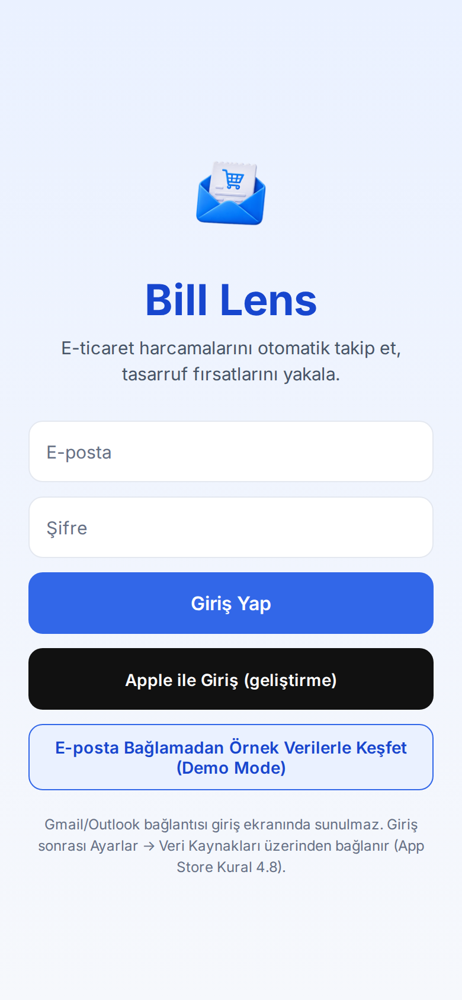
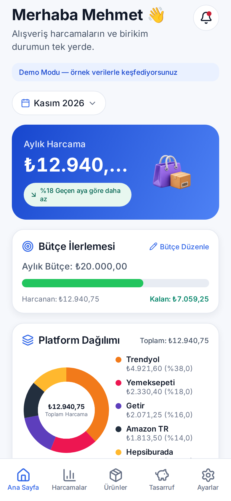
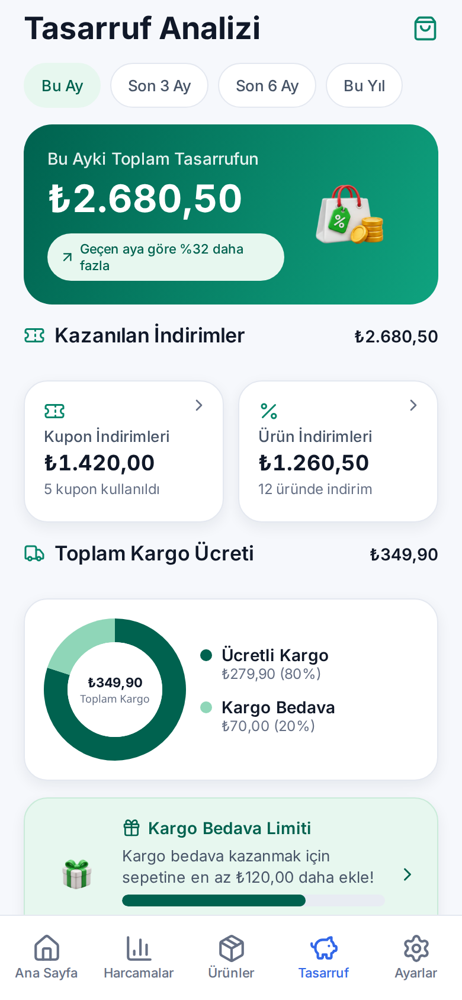
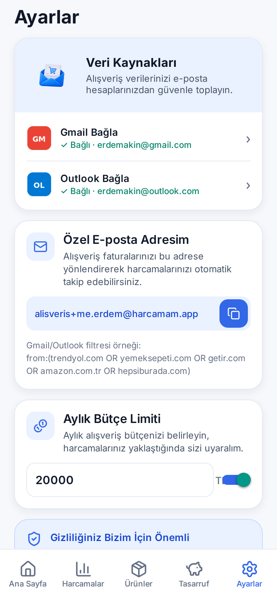

# Bill Lens

Bireysel e-ticaret harcama ve tasarruf analiz mobil uygulaması.

Trendyol, Yemeksepeti, Getir, Amazon TR ve Hepsiburada sipariş e-postalarını ayrıştırarak aylık harcama, bütçe, ürün fiyat geçmişi ve tasarruf analizini tek yerde sunar.

## Ekran görüntüleri

| Login / Demo | Ana Sayfa | Harcamalar |
| --- | --- | --- |
|  |  |  |

| Ürünler | Tasarruf | Ayarlar |
| --- | --- | --- |
|  |  |  |

## Yapı

- `mobile/` — Expo SDK 58, Expo Router, TypeScript, Zustand, TanStack Query, Firebase Auth/Firestore SDK
- `functions/` — Firebase Cloud Functions (Express API + e-posta parser pipeline)
- Firestore + Firebase Auth — kullanıcı, inbound alias, sipariş verisi (ayrı sunucu / Postgres yok)
- `app-store/` — mağaza inceleme notları ve listing taslakları
- `docs/screenshots/` — UI ekran görüntüleri
- `prd.md` — ürün / mimari dokümanı

## Hızlı başlangıç (mobil)

```bash
cd mobile
cp .env.example .env   # Firebase web config değerlerini doldurun
npm install
npx expo start
```

Demo Mode: giriş ekranında **E-posta Bağlamadan Örnek Verilerle Keşfet**.  
Firebase env’leri boşsa e-posta / Apple girişi yerel stub profille çalışır; production için Firebase zorunludur.

Web önizleme / ekran görüntüsü:

```bash
cd mobile
npx expo start --web --port 8081
node scripts/capture-screenshots.mjs
```

## Firebase backend

Ayrı bir VPS veya Postgres gerekmez. API, Auth ve veritabanı Firebase üzerindedir.

1. [Firebase Console](https://console.firebase.google.com/)’da proje oluşturun (veya `.firebaserc` içindeki `bill-lens` id’sini kendi projenizle değiştirin).
2. Authentication → Email/Password (+ isteğe bağlı Apple) açın.
3. Firestore Database oluşturun.
4. Deploy:

```bash
npm install -g firebase-tools
firebase login
cd functions && npm install && npm run build && cd ..
firebase deploy --only functions,firestore
```

Yerel emulator:

```bash
cd functions && npm install && npm run serve
```

API tabanı (deploy sonrası):

`https://europe-west1-<PROJECT_ID>.cloudfunctions.net/api`

| Endpoint | Açıklama |
| --- | --- |
| `GET /health` | sağlık kontrolü |
| `POST /auth/register` | Auth token ile Firestore profil + inbound alias |
| `POST /webhooks/inbound-email` | inbound e-posta parse & sipariş kaydı |
| `PATCH /user/budget` | aylık bütçe |
| `DELETE /user/account` | hesap + Firestore verisi + Auth kullanıcısı |

### Güvenlik

- Kullanıcı endpoint’leri (`/auth/register`, `/user/budget`, `/user/account`) **Firebase ID token** ister; token yoksa `401`. Her kullanıcı yalnızca **kendi** `uid` verisine dokunur.
- Firestore: sipariş / alias yazma istemciye kapalı; yalnızca Cloud Functions (Admin SDK).
- Inbound webhook production’da **`INBOUND_WEBHOOK_SECRET` zorunlu**; istekte `x-webhook-secret` olmalı. Secret yoksa `503`.
- `GET /health` herkese açık (yalnızca durum).

Functions ortamı: `INBOUND_WEBHOOK_SECRET=...` (güçlü rastgele). İsteğe bağlı: `OPENAI_API_KEY`.

Mobil env: `mobile/.env.example` → Firebase web app config + isteğe bağlı `EXPO_PUBLIC_API_URL`.

## Mağaza kimlikleri

Word Rush referansından uyarlandı:

- iOS bundle: `com.akintechstudio.billlens`
- Android package: `com.akintechstudio.billlens`
- Apple Team ID: `L9XFYWS8GJ`
- Expo owner: `mehmetea57`
