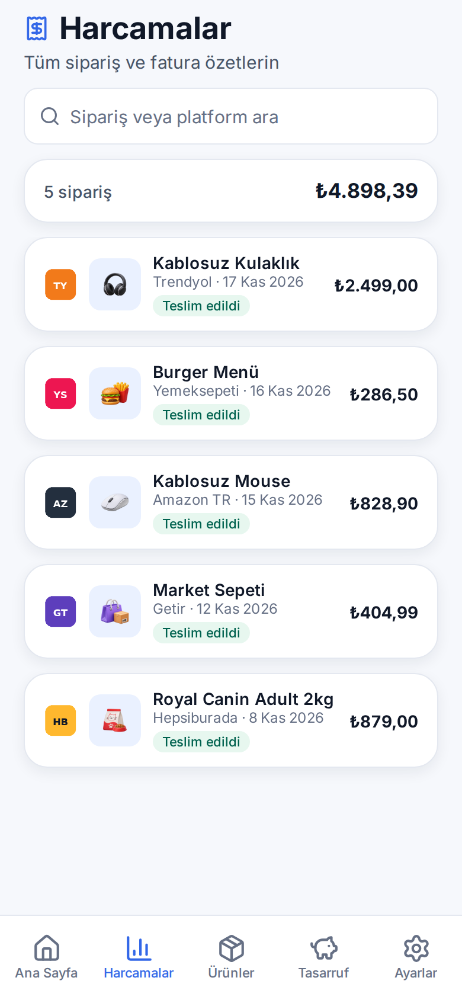
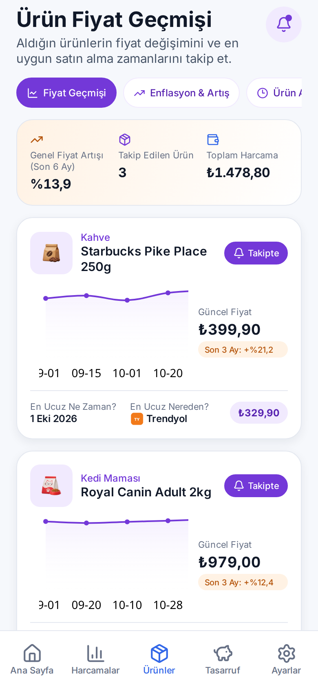

# Bill Lens

Bireysel e-ticaret harcama ve tasarruf analiz mobil uygulaması.

Trendyol, Yemeksepeti, Getir, Amazon TR ve Hepsiburada sipariş e-postalarını ayrıştırarak aylık harcama, bütçe, ürün fiyat geçmişi ve tasarruf analizini tek yerde sunar.

## Ekran görüntüleri

| Login / Demo | Ana Sayfa | Harcamalar |
| --- | --- | --- |
|  |  |  |

| Ürünler | Tasarruf | Ayarlar |
| --- | --- | --- |
|  |  |  |

## Yapı

- `mobile/` — Expo SDK 58, Expo Router, TypeScript, Zustand, TanStack Query
- `backend/` — Express + Prisma + PostgreSQL (inbound email webhook & parsers)
- `app-store/` — mağaza inceleme notları ve listing taslakları
- `docs/screenshots/` — UI ekran görüntüleri
- `prd.md` — ürün / mimari dokümanı

## Hızlı başlangıç (mobil)

```bash
cd mobile
npm install
npx expo start
```

Demo Mode: giriş ekranında **E-posta Bağlamadan Örnek Verilerle Keşfet**.

Web önizleme / ekran görüntüsü:

```bash
cd mobile
npx expo start --web --port 8081
node scripts/capture-screenshots.mjs
```

## Backend

```bash
docker compose up -d
cd backend
cp .env.example .env
npm install
npx prisma generate
npx prisma migrate dev --name init
npm run dev
```

Webhook: `POST /api/webhooks/inbound-email`  
Hesap silme: `DELETE /api/user/account` (`x-user-id` veya `x-user-email`)

## Mağaza kimlikleri

Word Rush referansından uyarlandı:

- iOS bundle: `com.akintechstudio.billlens`
- Android package: `com.akintechstudio.billlens`
- Apple Team ID: `L9XFYWS8GJ`
- Expo owner: `mehmetea57`
